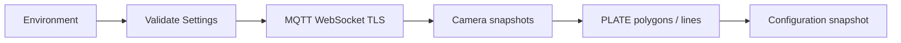

# PLATE Module VMS

Service đồng bộ cấu hình camera và vùng giám sát PLATE qua MQTT, phục vụ hệ
thống nhận diện phương tiện và biển số trong VMS.

## Chức năng

- Kết nối MQTT qua WebSocket TLS, tự reconnect khi mất kết nối.
- Đồng bộ camera PLATE theo organization và một hoặc nhiều zone.
- Nhận polygon và vạch IN/OUT, xử lý cập nhật và xóa retained.
- Quản lý cấu hình nhiều camera trong một registry.
- Cung cấp snapshot immutable cho ứng dụng đọc từ các thread khác nhau.
- Giới hạn queue và payload; đồng bộ lại khi queue quá tải.
- Đọc RTSP với queue một frame/camera, tự reconnect khi mất stream.
- Detect xe bằng một model dùng chung, xử lý camera luân phiên.

Một file `compose.yaml` cung cấp ba profile: `gpu`, `cpu`, `sync`. Profile GPU/CPU
chạy detection; các cờ môi trường bật OCR, event IN/OUT và bbox realtime.
Profile sync chỉ đồng bộ cấu hình camera/vạch.

## Yêu cầu

- Docker Engine hoặc Docker Desktop với Compose hỗ trợ `env_file.required`.
- Tài khoản MQTT có quyền publish request camera và subscribe cấu hình camera/vạch.
- Kết nối mạng tới MQTT broker qua WebSocket TLS.

## Cấu hình

Tạo `.env` theo [.env.example](.env.example) và điền các biến bắt buộc:

| Biến | Ý nghĩa |
|---|---|
| `MQTT_HOST` | Hostname broker, không có scheme, path hoặc cổng |
| `MQTT_USERNAME` | Tài khoản MQTT |
| `MQTT_PASSWORD` | Mật khẩu MQTT |
| `VMS_ORGANIZATION_ID` | Organization ID, số nguyên dương |
| `VMS_ZONE_IDS` | Danh sách zone ID dương, phân cách bằng dấu phẩy |

Các tùy chọn thường dùng:

| Biến | Mặc định | Ý nghĩa |
|---|---|---|
| `MQTT_PORT` | `443` | Cổng WebSocket TLS |
| `MQTT_WS_PATH` | `/mqtt` | WebSocket path |
| `MQTT_CLIENT_ID` | Tự sinh | Client ID duy nhất cho mỗi instance |
| `VMS_CAMERA_CODE` | Không giới hạn | Chỉ đồng bộ một camera nếu được đặt |
| `VMS_CAMERA_SYNC_SECONDS` | `30` | Chu kỳ request cấu hình camera |
| `LOG_LEVEL` | `INFO` | Mức log |

Settings được validate trước khi kết nối. Python đọc process environment;
Docker Compose inject `.env`. `.env` không được đưa vào Git hoặc Docker image.
Mỗi instance chạy song song cần client ID khác nhau.

## Khởi chạy

Tại thư mục dự án, chạy GPU:

```powershell
docker compose --profile gpu up -d --build
docker compose --profile gpu logs -f --tail 100 plate-sync
```

Dừng service:

```powershell
docker compose --profile gpu down
```

Chọn đúng một profile mỗi lần triển khai:

| Profile | Service | Chức năng |
|---|---|---|
| `gpu` | `plate-sync` | Inference với CUDA, dùng image CUDA đã có |
| `cpu` | `plate-cpu` | Inference bằng CPU, không yêu cầu GPU |
| `sync` | `plate-config` | Chỉ đồng bộ MQTT, không mở RTSP hoặc load model |

```powershell
docker compose --profile cpu up -d --build
docker compose --profile cpu logs -f --tail 100 plate-cpu
```

Chỉ đồng bộ cấu hình:

```powershell
docker compose --profile sync up -d --build
docker compose --profile sync logs -f --tail 100 plate-config
```

Khi đổi profile, dừng profile đang chạy trước bằng `docker compose --profile
<profile-hiện-tại> down`. Không bật nhiều profile cùng lúc để tránh nhiều instance
xử lý cùng camera. Lệnh không chỉ định profile sẽ không chọn service nào.

Container chạy với user không có quyền root, filesystem read-only và log rotation.
Runtime sync chỉ cần Python 3.12/Paho MQTT; CPU/GPU mount weight read-only.

Một `Dockerfile` chứa ba build target `sync`, `cpu`, `gpu`. Compose profile chọn
đúng target; không cần chọn Dockerfile khác hoặc tự truyền `--target` khi dùng
Compose. Target sync chỉ cài MQTT, target CPU cài Torch CPU, target GPU dùng
Torch/CUDA từ base image đã cấu hình. Các target độc lập nên build GPU không cài
Torch CPU. Khi build trực tiếp bằng Docker, luôn chỉ định `--target` mong muốn.

### Bật/tắt tính năng

Để chạy đầy đủ pipeline, đặt trong `.env`:

```dotenv
PLATE_OCR_ENABLED=true
PLATE_EVENTS_ENABLED=true
PLATE_BBOX_ENABLED=true
```

Nếu chỉ detect xe, đặt cả ba cờ `false`. Nếu chỉ OCR và bbox, đặt OCR/bbox `true`,
event `false`. Event và bbox đều yêu cầu OCR bật. Profile sync không sử dụng các
cờ AI. Với profile CPU/GPU, Compose mặc định ba cờ là `true` khi biến chưa được
khai báo; giá trị có sẵn trong `.env` được giữ nguyên, kể cả `false`.

Khi chuyển từ cấu hình nhiều file Compose, kiểm tra ba cờ trên: cấu hình cũ có
thể đã đặt `false` và được overlay ghi đè khi chạy. Cấu hình hiện tại lấy giá trị
trực tiếp từ biến môi trường hoặc `.env`. Sau khi đổi cờ, chạy lại lệnh `up -d`.
Bỏ khai báo `PLATE_DEVICE` để profile dùng device mặc định của image.

## Vehicle detection

Weight được đặt tại `models/weights/last_vehicle_s_07042023_640_hp.pt`. File
model không thuộc Git; manifest tại `models/manifest.json` ghi tên, checksum và
các lớp hỗ trợ. Khi triển khai trên máy khác, tạo thư mục `models/weights` và
cung cấp file model đúng checksum. Runtime kiểm tra SHA-256 trước khi load và
không tự tải weight.

Model mặc định có hai lớp `CAR`, `MOTORBIKE`, input 640, confidence 0.4 và IoU
0.45. Loader chỉ hỗ trợ kiến trúc detection đã đăng ký trong package model.

Chạy CPU:

```powershell
docker compose --profile cpu up -d --build
```

Chạy GPU với image CUDA `multi-camera-ai:cu128` có sẵn trên máy:

```powershell
docker compose --profile gpu up -d --build
```

Image GPU dùng Torch `2.10.0+cu128` và Torchvision `0.25.0+cu128`; build kiểm
tra cặp phiên bản trước khi cài dependency ứng dụng. Image CPU cài cặp tương
ứng `2.10.0+cpu` / `0.25.0+cpu`. Weight được mount read-only vào `/models`,
không nằm trong image. Service GPU là `plate-sync`, CPU là `plate-cpu`.
Đổi base image GPU bằng biến build `CUDA_BASE_IMAGE` nếu cần.

Dependency GPU bổ sung khóa tương thích `contourpy==1.3.3` trong
`requirements-cuda-compat.lock` để dùng cùng NumPy 1.26.4. Build chạy kiểm tra
dependency sau khi cài; Torch và Torchvision giữ nguyên phiên bản trong image CUDA.

Theo dõi detection:

```powershell
docker compose --profile gpu logs -f --tail 100 plate-sync
```

Log `Detection model loaded`, `RTSP connected` và `Vehicle detection` xác nhận
các giai đoạn vận hành. Log detection gồm camera, số frame, số xe, thời gian
inference và tuổi frame. `READY` là kết quả còn hạn; `STALE` bị loại khỏi cache.
Đây là kết quả detect xe, chưa phải nhận diện biển số.

### Cấu hình detection

Các giá trị mặc định dùng được ngay khi `.env` chỉ có phần MQTT/VMS. Các tùy
chọn detection nằm trong `.env.example`; chưa cần thêm tất cả vào `.env`.

| Biến | Mặc định | Ý nghĩa |
|---|---|---|
| `PLATE_DEVICE` | `cpu` / `cuda:0` theo image | Bỏ khai báo để dùng mặc định image |
| `PLATE_WEIGHTS_DIR` | `/models` trong image | Thư mục weight |
| `PLATE_VEHICLE_WEIGHT` | `last_vehicle_s_07042023_640_hp.pt` | Tên file weight |
| `PLATE_VEHICLE_SHA256` | Theo manifest | Hash bắt buộc khớp file model |
| `PLATE_IMAGE_SIZE` | `640` | Bội số 32 |
| `PLATE_VEHICLE_CONFIDENCE` | `0.4` | Ngưỡng confidence |
| `PLATE_VEHICLE_IOU` | `0.45` | Ngưỡng NMS |
| `PLATE_MAX_DETECTIONS` | `256` | Giới hạn xe/frame |
| `PLATE_MAX_FPS` | `5` | Giới hạn inference/camera |
| `PLATE_MAX_FRAME_AGE_SECONDS` | `1` | Tuổi tối đa của frame/kết quả |
| `PLATE_RTSP_OPEN_TIMEOUT_MS` | `5000` | Timeout mở stream |
| `PLATE_RTSP_READ_TIMEOUT_MS` | `2000` | Timeout đọc frame |
| `PLATE_RTSP_TRANSPORT` | `tcp` | TCP hoặc UDP |
| `PLATE_TORCH_THREADS` | `1` | Số thread CPU của Torch |
| `PLATE_SHUTDOWN_TIMEOUT_SECONDS` | `12` | Thời gian chờ runtime dừng |

Mỗi camera có một reader; một thread inference dùng chung model. Reader liên
tục thay frame đang chờ bằng frame mới. FPS là giới hạn trên, không đảm bảo đạt
5 FPS khi phần cứng không đủ tải nhiều camera. Khi camera bị xóa, đổi UUID hoặc
đổi RTSP source, reader được dừng và kết quả đang xử lý bị vô hiệu hóa. Reader
thay thế chỉ khởi động sau khi reader trước đã dừng. Đổi polygon/vạch không
restart RTSP; detect xe hoạt động trên toàn frame.

Timestamp được ghi sau khi decode frame tại AI, không phải PTS nguồn. Queue
mới nhất giúp giảm backlog nhưng không đảm bảo đồng bộ từng frame với video VMS.

### Đọc kết quả trong ứng dụng

```python
from plate_ai import CameraSyncService, DetectionSettings, Settings
from plate_ai.runtime import DetectionRuntime

with CameraSyncService(Settings.from_env()) as sync:
    with DetectionRuntime(sync, DetectionSettings.from_env()) as runtime:
        # Đọc trong vòng lặp ứng dụng; None khi chưa có kết quả hoặc đã hết hạn.
        result = runtime.latest("CAM_01")
        if result is not None:
            detections = result.detections
            frame = result.frame.image
```

Mỗi detection có `vehicle_type`, `confidence`, `bbox` pixel theo frame tương
ứng. Cache chỉ giữ một kết quả/frame mỗi camera để các bước xử lý tiếp theo có
crop đúng ảnh. Không sửa frame trong cache hoặc giữ nhiều frame ngoài runtime.

### Kiểm thử

Chạy bộ test trong image GPU, gồm model smoke test CPU/CUDA và test lifecycle
camera. Lệnh yêu cầu artifact model đã đặt trong `models/weights`:

```powershell
docker run --rm --gpus all --mount "type=bind,source=$($PWD.Path)\tests,target=/tests,readonly" --mount "type=bind,source=$($PWD.Path)\models\weights,target=/models,readonly" plate-module-vms:detection-cu128 /app/.venv/bin/python -m unittest discover -s /tests -v
```

## Nhận diện biển số và thuộc tính xe

Pipeline gồm detect xe → crop xe → detect biển số → crop biển → detect ký tự →
sắp xếp một/hai hàng → chuẩn hóa text `A-Z0-9`. Các giả thuyết ký tự trùng vị trí
được loại theo confidence. Text được chấp nhận khi dài 6–12 ký tự, có cả chữ và số;
đây là bộ lọc OCR cơ bản, chưa xác thực quy chuẩn hay đăng ký phương tiện.

Đặt đủ các artifact trong `models/weights`; filename, SHA-256 và input size được
ghi tại `models/manifest.json`:

| Vai trò | File | Input |
|---|---|---|
| Detect biển | `last_plate_n_12012023.pt` | 256 |
| Đọc ký tự | `last_digit_n_12012022.pt` | 256 |
| Hãng xe | `brand_v2_320.pt` | 320 |
| Màu xe | `color_v2_224.pt` | 224 |
| Màu biển | `last_color_29122022_v2.pt` | 128 |

Loader kiểm tra checksum trước khi giải mã từng checkpoint. Tất cả model dùng
chung device với vehicle detection. Không cần cài thêm dependency cho OCR.

Chạy CPU với nhận diện:

```powershell
docker compose --profile cpu up -d --build
```

Chạy GPU với nhận diện:

```powershell
docker compose --profile gpu up -d --build
docker compose --profile gpu logs -f --tail 100 plate-sync
```

OCR bật khi `PLATE_OCR_ENABLED=true`. Profile CPU/GPU dùng các cờ trong `.env`;
không cần file Compose bổ sung cho từng tính năng.

| Biến | Mặc định | Ý nghĩa |
|---|---|---|
| `PLATE_OCR_ENABLED` | `true` trong Compose | Bật worker trong chế độ detection |
| `PLATE_PLATE_CONFIDENCE` | `0.55` | Ngưỡng detect biển |
| `PLATE_CHARACTER_CONFIDENCE` | `0.35` | Ngưỡng detect ký tự |
| `PLATE_ATTRIBUTE_CONFIDENCE` | `0.5` | Ngưỡng nhận thuộc tính |
| `PLATE_OCR_INTERVAL_SECONDS` | `0.5` | Khoảng cách tối thiểu giữa lượt xử lý/camera |
| `PLATE_OCR_MAX_RESULT_AGE_SECONDS` | `2` | Hạn kết quả, tính từ lúc nhận frame |
| `PLATE_OCR_MAX_VEHICLES` | `16` | Số xe tối đa/lượt, ưu tiên confidence cao |
| `PLATE_OCR_MAX_PLATES_PER_VEHICLE` | `3` | Số biển ứng viên tối đa/xe |

Đổi artifact bằng `PLATE_<ROLE>_WEIGHT` và `PLATE_<ROLE>_SHA256`, với role
`PLATE`, `DIGIT`, `BRAND`, `COLOR`, `PLATE_COLOR`. Các model thay thế phải có
kiến trúc, tên lớp và preprocessing tương thích; input size cố định theo vai trò.

### Worker và vòng đời kết quả

Một worker OCR dùng chung năm model cho tất cả camera, xử lý luân phiên. Worker
lấy kết quả vehicle detection mới nhất khi đến lượt; không tạo hàng đợi frame
chờ OCR. Crop luôn lấy từ đúng frame của detection, không ghép bbox cũ với ảnh mới.
Cache OCR giữ một kết quả/camera, chỉ gồm metadata, không giữ thêm ảnh.

Nếu camera có polygon, chỉ OCR xe có điểm giữa cạnh đáy nằm trong polygon.
Nếu chỉ có vạch hoặc chưa có polygon, OCR trên toàn frame. Cập nhật camera hoặc
polygon/vạch vô hiệu hóa kết quả cũ; kết quả đang chạy chỉ được nhận nếu cấu hình
vẫn khớp và camera vẫn có detection còn hạn.

Worker detection và OCR chạy riêng, nhưng chia sẻ tài nguyên CPU/GPU. Nhiều xe
hoặc nhiều camera có thể làm giảm FPS; không đảm bảo đồng bộ frame với video Web.
Kết quả quá hạn bị loại, kể cả khi OCR vừa hoàn thành.

Log `Plate recognition` có camera, sequence, số xe được xử lý, số biển detect,
số biển đọc được, thời gian inference, tuổi frame và `READY`/`STALE`. Không log
RTSP source, ảnh hoặc text biển số. `recognized=0` không đồng nghĩa model detect
biển chưa chạy; cần xem đồng thời `plates`, `vehicles` và các ngưỡng cấu hình.

### Kết quả tích hợp

```python
from plate_ai.recognition_config import RecognitionSettings
from plate_ai.recognition_runtime import RecognitionRuntime

# sync và detection là các runtime đang hoạt động trong ứng dụng.
with RecognitionRuntime(sync, detection, RecognitionSettings()) as recognition:
    result = recognition.latest("CAM_01")
    if result is not None:
        for item in result.vehicles:
            text = item.license_plate.text
            plate_bbox = item.license_plate.bbox
            manufacturer = item.manufacturer
            color = item.color
```

Mỗi kết quả có camera, sequence, timestamp nguồn frame, thời điểm nhận frame,
thời gian xử lý và danh sách xe. `detection_index` liên kết với vị trí xe trong
kết quả detection cùng sequence; chưa phải track ID. Bbox xe/biển dùng pixel trên
cùng frame. Không áp bbox OCR của sequence cũ trực tiếp lên frame hiện tại.

`license_plate` gồm text, confidence OCR, bbox, confidence detection, plate_color
và status: `DETECTED`, `UNREADABLE`, `NOT_DETECTED`. Giữ được bbox ngay cả khi chưa
đọc ra text. Xe ngoài polygon hoặc vượt giới hạn lượt xử lý không có trong danh
sách OCR; dùng danh sách detection riêng để hiển thị tất cả xe.

Hãng/màu xe chỉ được phân loại cho `CAR` có text hợp lệ; màu biển được phân loại
khi đọc được biển. Nhãn dưới ngưỡng trả `None`. Màu `DARK`/`LIGHT` giữ đúng nhãn
model. Chưa có model `car_type`, số ghế, VIN hoặc chủ xe nên không suy diễn các
trường này. Chế độ chỉ bật OCR không publish sự kiện. Bật workflow sự kiện dưới
đây để theo dõi xe qua vạch và gửi nhận diện lên VMS.

## Lượt xe qua vạch và sự kiện PLATE

Chạy GPU với detect xe, OCR và sự kiện:

```powershell
docker compose --profile gpu up -d --build
docker compose --profile gpu logs -f --tail 100 plate-sync
```

Chạy CPU:

```powershell
docker compose --profile cpu up -d --build
```

Đặt `PLATE_OCR_ENABLED=true` và `PLATE_EVENTS_ENABLED=true` để bật sự kiện.
Broker cần cho phép publish `smart_vms/ai_events/PLATE`.

### Tracking và xác định hướng

- Mỗi camera có tracker riêng. Ghép xe bằng bài toán assignment theo loại xe,
  IoU và khoảng cách điểm giữa cạnh đáy, có dự đoán vận tốc.
- Điểm giữa cạnh đáy bbox phải đổi phía và quỹ đạo phải cắt **đoạn vạch**. Đi qua
  phần kéo dài của vạch không tạo sự kiện. Deadband giảm rung gần vạch.
- Vạch lấy từ `ai_zones/PLATE/lines`. Phía IN theo `direction_point` hoặc
  `direction_vector`; mặc định là phía trái của cặp đầu mút có hướng. Đi vào phía
  IN tạo `IN`, đi ra tạo `OUT`.
- Không có vạch thì vẫn detect/OCR, không tạo sự kiện qua vạch. Khi cập nhật vạch,
  xóa trạng thái phía cũ và chỉ dùng các frame nhận sau cập nhật để xác định lượt mới.
- Mỗi track chỉ chốt lượt qua vạch đầu tiên, kể cả khi xe quay lại hoặc cắt thêm
  vạch khác. Thêm camera tự tạo tracker; đổi UUID/source tạo phiên tracking mới.

Lịch sử metadata detection giữ sequence, thời điểm nhận, kích thước ảnh và bbox,
không giữ frame ảnh. Worker passage đọc các metadata còn hạn, ghép OCR bằng đúng
`(sequence, received_monotonic, detection_index)` của camera. OCR thiếu lịch sử
tương ứng bị bỏ qua; không gán sang xe hiện tại theo bbox gần nhất. Mỗi track tích
lũy tối đa 16 giả thuyết biển, chọn text theo số lượt đọc rồi tổng confidence.

### Chốt và gửi sự kiện

Sau khi cắt vạch, chờ mặc định 2 giây để nhận thêm OCR. Thời gian sự kiện là lúc
frame đầu tiên xác nhận qua vạch được nhận tại AI, biểu diễn ISO 8601 `+07:00`.
Payload chỉ được tạo một lần khi hết thời gian chờ, giữ nguyên trong các lần retry.
Nếu chưa đọc được biển thì text rỗng, status `NOT_DETECTED`; không gửi một sự kiện
bổ sung cho cùng track khi OCR đến muộn.

Publish lên `smart_vms/ai_events/PLATE`, **QoS 1, không retain**:

```json
{
  "ai_modules": "PLATE",
  "camera_id": "<camera uuid>",
  "event_time": "2026-10-27T08:30:00.000+07:00",
  "entity_type": "VEHICLE",
  "entity_id": "CAM_01_<session>_1",
  "payload": {
    "object_key": "CAM_01_<session>_1",
    "direction": "IN",
    "confidence": 0.95,
    "vehicle": {
      "license_plate": {"text": "30A12345", "status": "DETECTED", "plate_color": "WHITE"},
      "vehicle_type": "CAR",
      "car_type": null,
      "manufacturer": "TOYOTA",
      "color": "DARK",
      "total_number_of_seats": null,
      "chassis_number": null,
      "owner_name": null
    }
  },
  "snapshot_url": null,
  "snapshot_base64": null
}
```

Biển chỉ nằm ở `payload.vehicle.license_plate.text`, chuẩn hóa `A-Z0-9`. Không gửi
blacklist/whitelist; VMS tự đối chiếu. Không gửi `violation_type_code` vì workflow
này chưa có bộ luật phát hiện vi phạm. Các thuộc tính chưa xác định để `null`.

### Queue, retry và log

Pending event giới hạn trên toàn bộ camera. Khi MQTT chưa kết nối hoặc queue đầy,
retry theo chu kỳ, tối đa đến TTL tính từ lúc qua vạch. Pending đã chốt được giữ
khi camera bị gỡ hoặc discovery làm mới; việc gỡ camera ngừng tạo lượt mới.
Khi hết TTL hoặc queue pending đầy, log nêu rõ sự kiện bị loại.

Mỗi lần publish log đủ `topic`, `camera`, `object_key`, `result`:

| Result | Ý nghĩa |
|---|---|
| `QUEUED` | Paho nhận bản tin vào outgoing queue |
| `QUEUED_RECONNECT` | Mất kết nối trong lúc publish; QoS 1 đã được giữ trong queue |
| `BROKER_ACK` | Đã nhận PUBACK từ broker |
| `BROKER_REJECTED` | Broker báo không nhận bản tin |
| `DISCONNECTED` / `QUEUE_FULL` / `REJECTED_RC_*` | Chưa nhận vào queue, worker sẽ retry trong TTL |

`BROKER_ACK` chưa xác nhận VMS đã lưu database. Sau khi Paho nhận bản tin, worker
không tạo thêm application message cho track đó; Paho tự xử lý truyền lại QoS 1.
QoS 1 có thể giao bản tin trùng. Tracker cũng có thể mất ID khi che khuất, xe sát
nhau, mất stream hoặc restart, nên chưa bảo đảm một sự kiện duy nhất cho một xe
vật lý trên mọi lần chạy. `entity_id`/`payload.object_key` ổn định cho từng track.

Queue chỉ ở RAM, không khôi phục sau restart. TTL pending chỉ áp dụng trước khi
Paho nhận bản tin; bản tin đã nhận có thể được gửi lại khi reconnect sau TTL.
Shutdown báo số pending chưa gửi; Compose cho phép tối đa 75 giây để dừng các
worker. Không tạo sự kiện giả khi khởi động. Bbox realtime thuộc workflow riêng.

### Cấu hình sự kiện

| Biến | Mặc định | Ý nghĩa |
|---|---|---|
| `PLATE_EVENTS_ENABLED` | `true` trong Compose | Bật passage worker; yêu cầu OCR bật |
| `PLATE_TRACK_TTL_SECONDS` | `2` | Giữ track khi mất detection |
| `PLATE_MAX_TRACKS` | `128` | Số track tối đa/camera |
| `PLATE_CROSSING_DEADBAND` | `0.01` | Khoảng cách chuẩn hóa quanh vạch |
| `PLATE_EVENT_OCR_WAIT_SECONDS` | `2` | Chờ OCR sau khi qua vạch |
| `PLATE_EVENT_PENDING_TTL_SECONDS` | `30` | Hạn retry trước queue acceptance |
| `PLATE_EVENT_MAX_PENDING` | `128` | Số event chờ trên toàn hệ thống |
| `PLATE_EVENT_RETRY_SECONDS` | `1` | Chu kỳ retry |
| `PLATE_TRACK_HISTORY_SECONDS` | `4` | Hạn metadata; phải phủ hạn kết quả OCR |
| `PLATE_TRACK_HISTORY_FRAMES` | `64` | Số metadata tối đa/camera |

Với tích hợp Python, tạo `DetectionRuntime(..., metadata_frames=64,
metadata_seconds=4)`, khởi động `RecognitionRuntime`, sau đó khởi động
`PassageRuntime(sync, detection, recognition, PassageSettings())`. Dừng theo thứ
tự ngược lại. `publish` có thể inject callable nhận `(event, *, camera_code,
object_key)` và trả `True` khi đã nhận vào queue. Không block callable để đợi
network acknowledgement.

## Bbox realtime và text biển số

Chạy đầy đủ detection, OCR, sự kiện qua vạch và bbox trên GPU:

```powershell
docker compose --profile gpu up -d --build
docker compose --profile gpu logs -f --tail 100 plate-sync
```

Với CPU, dùng `--profile cpu`. Đặt `PLATE_OCR_ENABLED=true` và
`PLATE_BBOX_ENABLED=true` để bật overlay. Nếu không gửi sự kiện qua vạch, đặt
`PLATE_EVENTS_ENABLED=false`. Các tính năng dùng chung một file Compose.

### Payload overlay

Publish `smart_vms/ai/bbox/{camera_code}`, **QoS 0, không retain**,
`ai_modules: PLATE`, bbox `[x1, y1, x2, y2]` chuẩn hóa trong khoảng 0..1:

```json
{
  "camera_code": "CAM_01",
  "camera_id": "<camera uuid>",
  "organization_id": 110,
  "ai_modules": "PLATE",
  "timestamp": 1793064600.123,
  "published_at": 1793064600.203,
  "frame_sequence": 120,
  "frame_age_ms": 80,
  "detections": [
    {"id": "CAM_01_<session>_1", "global_id": "CAM_01_<session>_1", "track_id": 1,
     "class": "car", "confidence": 0.95, "bbox": [0.1, 0.2, 0.5, 0.8]},
    {"id": "CAM_01_<session>_1:plate", "global_id": "CAM_01_<session>_1:plate", "track_id": 1,
     "class": "license_plate: 30A12345", "text": "30A12345", "confidence": 0.91,
     "text_confidence": 0.94, "bbox": [0.22, 0.67, 0.36, 0.72]}
  ],
  "hud": {"text": "IN: 12 | OUT: 8", "display_ms": 350, "color": "#22c55e"}
}
```

Khung biển dùng `class` chứa text để client hiển thị được ngay khi chỉ vẽ nhãn
`class`; `text` và `text_confidence` cũng được gửi riêng. Nếu detect được biển
nhưng chưa đọc ra text, nhãn là `license_plate`. Xe và biển có cùng `track_id`,
nhưng `id`/`global_id` của biển có hậu tố `:plate`.

ID xe dùng chung với `entity_id`/`payload.object_key` của sự kiện PLATE. Dữ liệu
nhận diện lưu trữ vẫn gửi qua topic event; bbox phục vụ overlay. Không tự tạo
tọa độ map/PDF hoặc dữ liệu heatmap khi chưa có phép ánh xạ.

### Luồng realtime và giới hạn độ trễ

- Một worker bbox lấy snapshot immutable mới nhất từ tracker, mặc định tối đa
  10 bản tin/giây/camera. Không đợi OCR hoặc sự kiện hoàn thành để gửi khung xe.
- Bbox dùng kết nối MQTT WebSocket TLS riêng, cùng tài khoản và client ID có hậu
  tố `-bbox`. Queue sự kiện QoS 1 và config không dùng socket của overlay.
- Publisher chỉ cho phép một packet overlay chưa gửi xong trên kết nối bbox.
  Khi socket bận hoặc mất kết nối, bỏ bản tin mới; không tạo queue retry theo frame.
  Scheduler luân phiên camera bắt đầu để chia lượt khi socket bận.
- Có thể gửi lại snapshot còn mới giữa hai lần detect để duy trì overlay. Không
  gửi bbox của frame quá 0.3 giây. Khi hết hạn, mất camera hoặc đổi source, gửi
  payload `detections: []` để xóa khung nếu trước đó có khung. Payload xóa cũng
  có thể bị drop; Web tự hết hạn khung nếu không nhận bản tin tiếp theo.
- Khung biển được lưu tương đối trong crop xe của frame OCR, sau đó chiếu vào
  bbox xe hiện tại. Đây là phép chiếu theo track xe, chưa phải tracker biển số
  riêng; có thể lệch khi xe xoay hoặc đổi góc nhìn. Khung/text biển hết hạn sau
  1 giây tính từ frame OCR. OCR mới tiếp tục cập nhật overlay sau khi event đã gửi.

`timestamp` là thời điểm AI nhận frame sau decode, không phải PTS camera hay
thời điểm video được phát trên Web. `published_at`, `frame_sequence`,
`frame_age_ms` giúp quan sát độ trễ; VMS có thể bỏ qua các field bổ sung này.
Các biện pháp trên giảm backlog tại AI, không đảm bảo khớp từng frame video qua
MQTT. Một packet đã đưa xuống socket vẫn có thể đến muộn khi mạng/broker chậm.

Nếu GPU không đạt đủ FPS hoặc OCR chưa hoàn tất trong hạn, khung có thể gián đoạn
hoặc tạm thời chỉ có khung xe. Chỉ tăng hạn bbox khi chấp nhận hiển thị kết quả cũ
lâu hơn. Trên VMS, camera phải đang mở, nút phát hiện AI bật, chức năng chọn là
PLATE và camera đã bật module PLATE.

HUD đếm lượt cắt vạch đầu tiên của mỗi track trong phiên chạy, không phải số event
đã lưu database. Counter reset khi tạo phiên tracking mới cho camera. Bbox vẫn
hoạt động khi chưa có vạch; khi đó không có lượt IN/OUT để tăng counter.

### Cấu hình bbox và log

| Biến | Mặc định | Ý nghĩa |
|---|---|---|
| `PLATE_BBOX_ENABLED` | `true` trong Compose | Bật worker bbox, yêu cầu OCR bật |
| `PLATE_BBOX_MAX_FPS` | `10` | Giới hạn publish/camera |
| `PLATE_BBOX_MAX_FRAME_AGE_SECONDS` | `0.3` | Hạn frame overlay |
| `PLATE_BBOX_PLATE_MAX_AGE_SECONDS` | `1` | Hạn khung/text biển từ frame OCR |
| `PLATE_BBOX_TOPIC_PREFIX` | `smart_vms/ai/bbox` | Có thể chọn `smart_vms/bbox` |

Chỉ publish một prefix mỗi instance. Không gửi đồng thời cả hai alias để tránh
backend chuyển cùng overlay hai lần. Broker cần cho phép client bbox kết nối
và publish prefix đã chọn. Không cần dependency hay weight bổ sung.

Log `PLATE bbox worker started`, `MQTT bbox connected` xác nhận khởi động và kết
nối. Mỗi lần publish có `topic`, `camera`, `object_key=frame:<sequence>` và result:

- `QUEUED_QOS0`: Paho đã nhận packet, chưa xác nhận Web đã nhận/vẽ khung.
- `DROPPED_BUSY`: packet trước chưa gửi xong, bỏ lượt hiện tại.
- `DROPPED_DISCONNECTED`: client bbox chưa kết nối.
- `DROPPED_RC_*` / `DROPPED_<error>`: lỗi gửi, không retry bản tin cũ.

QoS 0 không có PUBACK. Log từng bản tin có thể tăng dung lượng khi nhiều camera;
Compose đã bật log rotation và đặt thời gian dừng container 75 giây
để dừng worker bbox, tracking, OCR, detection và sync theo thứ tự.

## Luồng đồng bộ




| Chiều | Topic | Nội dung |
|---|---|---|
| Publish, QoS 1, không retain | `smart_vms/cameras/getdevice` | `{zone_id, organization_id}` |
| Subscribe, QoS 1 | `smart_vms/cameras/zone/{zone_id}` | Snapshot camera đầy đủ của zone |
| Subscribe, QoS 1 | `smart_vms/cameras/{camera_code}/ai_zones/#` | Polygon, vạch và cập nhật retained |

Camera phải có UUID, `code`, RTSP source hợp lệ, module PLATE và trạng thái
hoạt động. Chế độ `sync` chỉ giữ metadata; chế độ `detection` mở RTSP của các
camera trong snapshot.

Snapshot không đủ `total` hoặc sai organization/zone bị từ chối. Xóa camera ở
một zone vẫn giữ camera nếu nó còn trong zone khác. Camera cùng code nhưng khác
UUID giữa các zone bị từ chối. Cùng UUID thì dùng định nghĩa từ snapshot vừa
nhận để hỗ trợ cập nhật source.

`ai_zones/PLATE/lines` nhận mảng hoặc object `{"lines": [...]}`. Mỗi vạch có
id/code và hai điểm chuẩn hóa 0..1; `direction_point` hoặc `direction_vector`
xác định phía IN. Mặc định phía IN là phía trái của cặp đầu mút có hướng.
Polygon có ít nhất ba điểm và khai báo `ai_modules: PLATE`.

Retained payload rỗng xóa cấu hình tương ứng. Snapshot polygon giữ vạch ở topic
riêng. Khi reconnect hoặc queue đầy, registry được làm mới và request lại
snapshot đầy đủ.

## Tích hợp

```python
from plate_ai import CameraSyncService, Settings

with CameraSyncService(Settings.from_env()) as service:
    # Đọc trong vòng lặp ứng dụng sau khi nhận cấu hình MQTT.
    state = service.snapshot()
    for config in state.cameras:
        camera = config.camera
        zones = config.zones
```

`state.revision` tăng khi cấu hình thay đổi. Snapshot có thể rỗng ngay sau
`start()` vì đồng bộ bất đồng bộ. Host theo dõi revision để cập nhật các thành
phần phụ thuộc. Snapshot chứa RTSP source nên không ghi toàn bộ ra log.

## Log vận hành

Log sử dụng UTC với hậu tố `Z`. Các mốc chính:

- `Camera sync started`: controller đã khởi động.
- `MQTT connected`: kết nối broker thành công.
- `publish ... result=QUEUED`: request được MQTT client nhận vào queue.
- `Synchronized PLATE cameras`: đã nhận snapshot camera.
- `PLATE configuration ... polygons=... lines=...`: đã nhận vùng/vạch.
- `MQTT subscription rejected`: broker từ chối subscription, cần kiểm tra ACL.

Log không chứa RTSP URL, mật khẩu hoặc raw MQTT payload. `QUEUED` chưa xác nhận
VMS xử lý request; snapshot trả về xác nhận service đã nhận được cấu hình.
