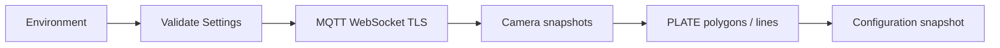

# PLATE Module VMS

Service đồng bộ cấu hình camera và vùng giám sát PLATE qua MQTT, phục vụ hệ
thống nhận diện phương tiện và biển số trong VMS.

## Chức năng

- Kết nối MQTT qua WebSocket TLS, tự reconnect khi mất kết nối.
- Đồng bộ camera PLATE theo organization và một hoặc nhiều zone.
- Nhận polygon và vạch IN/OUT, xử lý cập nhật và xóa retained.
- Quản lý cấu hình nhiều camera trong một registry.
- Cung cấp snapshot immutable cho ứng dụng đọc từ các thread khác nhau.
- Giới hạn queue và payload; đồng bộ lại khi queue quá tải.
- Đọc RTSP với queue một frame/camera, tự reconnect khi mất stream.
- Detect xe bằng một model dùng chung, xử lý camera luân phiên.

Hai chế độ vận hành: `sync` đồng bộ cấu hình; `detection` bổ sung đọc RTSP và
detect xe. OCR, event PLATE và bbox MQTT chưa được bật trong workflow detection.

## Yêu cầu

- Docker Engine hoặc Docker Desktop với Compose hỗ trợ `env_file.required`.
- Tài khoản MQTT có quyền publish request camera và subscribe cấu hình camera/vạch.
- Kết nối mạng tới MQTT broker qua WebSocket TLS.

## Cấu hình

Tạo `.env` theo [.env.example](.env.example) và điền các biến bắt buộc:

| Biến | Ý nghĩa |
|---|---|
| `MQTT_HOST` | Hostname broker, không có scheme, path hoặc cổng |
| `MQTT_USERNAME` | Tài khoản MQTT |
| `MQTT_PASSWORD` | Mật khẩu MQTT |
| `VMS_ORGANIZATION_ID` | Organization ID, số nguyên dương |
| `VMS_ZONE_IDS` | Danh sách zone ID dương, phân cách bằng dấu phẩy |

Các tùy chọn thường dùng:

| Biến | Mặc định | Ý nghĩa |
|---|---|---|
| `MQTT_PORT` | `443` | Cổng WebSocket TLS |
| `MQTT_WS_PATH` | `/mqtt` | WebSocket path |
| `MQTT_CLIENT_ID` | Tự sinh | Client ID duy nhất cho mỗi instance |
| `VMS_CAMERA_CODE` | Không giới hạn | Chỉ đồng bộ một camera nếu được đặt |
| `VMS_CAMERA_SYNC_SECONDS` | `30` | Chu kỳ request cấu hình camera |
| `LOG_LEVEL` | `INFO` | Mức log |

Settings được validate trước khi kết nối. Python đọc process environment;
Docker Compose inject `.env`. `.env` không được đưa vào Git hoặc Docker image.
Mỗi instance chạy song song cần client ID khác nhau.

## Khởi chạy

Tại thư mục dự án:

```powershell
docker compose up -d --build
docker compose logs -f --tail 100 plate-sync
```

Dừng service:

```powershell
docker compose down
```

Runtime sync sử dụng Python 3.12 và Paho MQTT. Container chạy với user không có
quyền root, filesystem read-only và log rotation. Workflow sync không yêu cầu GPU.

## Vehicle detection

Weight được đặt tại `models/weights/last_vehicle_s_07042023_640_hp.pt`. File
model không thuộc Git; manifest tại `models/manifest.json` ghi tên, checksum và
các lớp hỗ trợ. Khi triển khai trên máy khác, tạo thư mục `models/weights` và
cung cấp file model đúng checksum. Runtime kiểm tra SHA-256 trước khi load và
không tự tải weight.

Model mặc định có hai lớp `CAR`, `MOTORBIKE`, input 640, confidence 0.4 và IoU
0.45. Loader chỉ hỗ trợ kiến trúc detection đã đăng ký trong package model.

Chạy CPU:

```powershell
docker compose -f compose.yaml -f compose.detection.yaml up -d --build
```

Chạy GPU với image CUDA `multi-camera-ai:cu128` có sẵn trên máy:

```powershell
docker compose -f compose.yaml -f compose.detection.yaml -f compose.gpu.yaml up -d --build
```

Image GPU dùng Torch `2.10.0+cu128` và Torchvision `0.25.0+cu128`; build kiểm
tra cặp phiên bản trước khi cài dependency ứng dụng. Image CPU cài cặp tương
ứng `2.10.0+cpu` / `0.25.0+cpu`. Weight được mount read-only vào `/models`,
không nằm trong image. Tên service Compose vẫn là `plate-sync` ở cả hai chế độ.

Dependency GPU bổ sung khóa tương thích `contourpy==1.3.3` trong
`requirements-cuda-compat.lock` để dùng cùng NumPy 1.26.4. Build chạy kiểm tra
dependency sau khi cài; Torch và Torchvision giữ nguyên phiên bản trong image CUDA.

Theo dõi detection:

```powershell
docker compose -f compose.yaml -f compose.detection.yaml -f compose.gpu.yaml logs -f --tail 100 plate-sync
```

Log `Vehicle model loaded`, `RTSP connected` và `Vehicle detection` xác nhận
các giai đoạn vận hành. Log detection gồm camera, số frame, số xe, thời gian
inference và tuổi frame. `READY` là kết quả còn hạn; `STALE` bị loại khỏi cache.
Đây là kết quả detect xe, chưa phải nhận diện biển số.

### Cấu hình detection

Các giá trị mặc định dùng được ngay khi `.env` chỉ có phần MQTT/VMS. Các tùy
chọn detection nằm trong `.env.example`; chưa cần thêm tất cả vào `.env`.

| Biến | Mặc định | Ý nghĩa |
|---|---|---|
| `PLATE_DEVICE` | `cpu` / `cuda:0` theo image | Bỏ khai báo để dùng mặc định image |
| `PLATE_WEIGHTS_DIR` | `/models` trong image | Thư mục weight |
| `PLATE_VEHICLE_WEIGHT` | `last_vehicle_s_07042023_640_hp.pt` | Tên file weight |
| `PLATE_VEHICLE_SHA256` | Theo manifest | Hash bắt buộc khớp file model |
| `PLATE_IMAGE_SIZE` | `640` | Bội số 32 |
| `PLATE_VEHICLE_CONFIDENCE` | `0.4` | Ngưỡng confidence |
| `PLATE_VEHICLE_IOU` | `0.45` | Ngưỡng NMS |
| `PLATE_MAX_DETECTIONS` | `256` | Giới hạn xe/frame |
| `PLATE_MAX_FPS` | `5` | Giới hạn inference/camera |
| `PLATE_MAX_FRAME_AGE_SECONDS` | `1` | Tuổi tối đa của frame/kết quả |
| `PLATE_RTSP_OPEN_TIMEOUT_MS` | `5000` | Timeout mở stream |
| `PLATE_RTSP_READ_TIMEOUT_MS` | `2000` | Timeout đọc frame |
| `PLATE_RTSP_TRANSPORT` | `tcp` | TCP hoặc UDP |
| `PLATE_TORCH_THREADS` | `1` | Số thread CPU của Torch |
| `PLATE_SHUTDOWN_TIMEOUT_SECONDS` | `12` | Thời gian chờ runtime dừng |

Mỗi camera có một reader; một thread inference dùng chung model. Reader liên
tục thay frame đang chờ bằng frame mới. FPS là giới hạn trên, không đảm bảo đạt
5 FPS khi phần cứng không đủ tải nhiều camera. Khi camera bị xóa, đổi UUID hoặc
đổi RTSP source, reader được dừng và kết quả đang xử lý bị vô hiệu hóa. Reader
thay thế chỉ khởi động sau khi reader trước đã dừng. Đổi polygon/vạch không
restart RTSP; detect xe hoạt động trên toàn frame.

Timestamp được ghi sau khi decode frame tại AI, không phải PTS nguồn. Queue
mới nhất giúp giảm backlog nhưng không đảm bảo đồng bộ từng frame với video VMS.

### Đọc kết quả trong ứng dụng

```python
from plate_ai import CameraSyncService, DetectionSettings, Settings
from plate_ai.runtime import DetectionRuntime

with CameraSyncService(Settings.from_env()) as sync:
    with DetectionRuntime(sync, DetectionSettings.from_env()) as runtime:
        # Đọc trong vòng lặp ứng dụng; None khi chưa có kết quả hoặc đã hết hạn.
        result = runtime.latest("CAM_01")
        if result is not None:
            detections = result.detections
            frame = result.frame.image
```

Mỗi detection có `vehicle_type`, `confidence`, `bbox` pixel theo frame tương
ứng. Cache chỉ giữ một kết quả/frame mỗi camera để các bước xử lý tiếp theo có
crop đúng ảnh. Không sửa frame trong cache hoặc giữ nhiều frame ngoài runtime.

### Kiểm thử

Chạy bộ test trong image GPU, gồm model smoke test CPU/CUDA và test lifecycle
camera. Lệnh yêu cầu artifact model đã đặt trong `models/weights`:

```powershell
docker run --rm --gpus all --mount "type=bind,source=$($PWD.Path)\tests,target=/tests,readonly" --mount "type=bind,source=$($PWD.Path)\models\weights,target=/models,readonly" plate-module-vms:detection-cu128 /app/.venv/bin/python -m unittest discover -s /tests -v
```

## Luồng đồng bộ



| Chiều | Topic | Nội dung |
|---|---|---|
| Publish, QoS 1, không retain | `smart_vms/cameras/getdevice` | `{zone_id, organization_id}` |
| Subscribe, QoS 1 | `smart_vms/cameras/zone/{zone_id}` | Snapshot camera đầy đủ của zone |
| Subscribe, QoS 1 | `smart_vms/cameras/{camera_code}/ai_zones/#` | Polygon, vạch và cập nhật retained |

Camera phải có UUID, `code`, RTSP source hợp lệ, module PLATE và trạng thái
hoạt động. Chế độ `sync` chỉ giữ metadata; chế độ `detection` mở RTSP của các
camera trong snapshot.

Snapshot không đủ `total` hoặc sai organization/zone bị từ chối. Xóa camera ở
một zone vẫn giữ camera nếu nó còn trong zone khác. Camera cùng code nhưng khác
UUID giữa các zone bị từ chối. Cùng UUID thì dùng định nghĩa từ snapshot vừa
nhận để hỗ trợ cập nhật source.

`ai_zones/PLATE/lines` nhận mảng hoặc object `{"lines": [...]}`. Mỗi vạch có
id/code và hai điểm chuẩn hóa 0..1; `direction_point` hoặc `direction_vector`
xác định phía IN. Mặc định phía IN là phía trái của cặp đầu mút có hướng.
Polygon có ít nhất ba điểm và khai báo `ai_modules: PLATE`.

Retained payload rỗng xóa cấu hình tương ứng. Snapshot polygon giữ vạch ở topic
riêng. Khi reconnect hoặc queue đầy, registry được làm mới và request lại
snapshot đầy đủ.

## Tích hợp

```python
from plate_ai import CameraSyncService, Settings

with CameraSyncService(Settings.from_env()) as service:
    # Đọc trong vòng lặp ứng dụng sau khi nhận cấu hình MQTT.
    state = service.snapshot()
    for config in state.cameras:
        camera = config.camera
        zones = config.zones
```

`state.revision` tăng khi cấu hình thay đổi. Snapshot có thể rỗng ngay sau
`start()` vì đồng bộ bất đồng bộ. Host theo dõi revision để cập nhật các thành
phần phụ thuộc. Snapshot chứa RTSP source nên không ghi toàn bộ ra log.

## Log vận hành

Log sử dụng UTC với hậu tố `Z`. Các mốc chính:

- `Camera sync started`: controller đã khởi động.
- `MQTT connected`: kết nối broker thành công.
- `publish ... result=QUEUED`: request được MQTT client nhận vào queue.
- `Synchronized PLATE cameras`: đã nhận snapshot camera.
- `PLATE configuration ... polygons=... lines=...`: đã nhận vùng/vạch.
- `MQTT subscription rejected`: broker từ chối subscription, cần kiểm tra ACL.

Log không chứa RTSP URL, mật khẩu hoặc raw MQTT payload. `QUEUED` chưa xác nhận
VMS xử lý request; snapshot trả về xác nhận service đã nhận được cấu hình.
