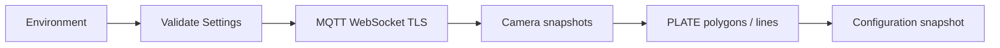

# PLATE Module VMS

Service đồng bộ cấu hình camera và vùng giám sát PLATE qua MQTT, phục vụ hệ
thống nhận diện phương tiện và biển số trong VMS.

## Chức năng

- Kết nối MQTT qua WebSocket TLS, tự reconnect khi mất kết nối.
- Đồng bộ camera PLATE theo organization và một hoặc nhiều zone.
- Nhận polygon và vạch IN/OUT, xử lý cập nhật và xóa retained.
- Quản lý cấu hình nhiều camera trong một registry.
- Cung cấp snapshot immutable cho ứng dụng đọc từ các thread khác nhau.
- Giới hạn queue và payload; đồng bộ lại khi queue quá tải.

Phiên bản hiện tại cung cấp workflow đồng bộ cấu hình. Xử lý RTSP, inference,
OCR, event và overlay được phát triển thành các workflow riêng.

## Yêu cầu

- Docker Engine hoặc Docker Desktop với Compose hỗ trợ `env_file.required`.
- Tài khoản MQTT có quyền publish request camera và subscribe cấu hình camera/vạch.
- Kết nối mạng tới MQTT broker qua WebSocket TLS.

## Cấu hình

Tạo `.env` theo [.env.example](.env.example) và điền các biến bắt buộc:

| Biến | Ý nghĩa |
|---|---|
| `MQTT_HOST` | Hostname broker, không có scheme, path hoặc cổng |
| `MQTT_USERNAME` | Tài khoản MQTT |
| `MQTT_PASSWORD` | Mật khẩu MQTT |
| `VMS_ORGANIZATION_ID` | Organization ID, số nguyên dương |
| `VMS_ZONE_IDS` | Danh sách zone ID dương, phân cách bằng dấu phẩy |

Các tùy chọn thường dùng:

| Biến | Mặc định | Ý nghĩa |
|---|---|---|
| `MQTT_PORT` | `443` | Cổng WebSocket TLS |
| `MQTT_WS_PATH` | `/mqtt` | WebSocket path |
| `MQTT_CLIENT_ID` | Tự sinh | Client ID duy nhất cho mỗi instance |
| `VMS_CAMERA_CODE` | Không giới hạn | Chỉ đồng bộ một camera nếu được đặt |
| `VMS_CAMERA_SYNC_SECONDS` | `30` | Chu kỳ request cấu hình camera |
| `LOG_LEVEL` | `INFO` | Mức log |

Settings được validate trước khi kết nối. Python đọc process environment;
Docker Compose inject `.env`. `.env` không được đưa vào Git hoặc Docker image.
Mỗi instance chạy song song cần client ID khác nhau.

## Khởi chạy

Tại thư mục dự án:

```powershell
docker compose up -d --build
docker compose logs -f --tail 100 plate-sync
```

Dừng service:

```powershell
docker compose down
```

Runtime sử dụng Python 3.12 và Paho MQTT. Container chạy với user không có quyền
root, filesystem read-only và log rotation. Workflow đồng bộ không yêu cầu GPU.

## Luồng đồng bộ



| Chiều | Topic | Nội dung |
|---|---|---|
| Publish, QoS 1, không retain | `smart_vms/cameras/getdevice` | `{zone_id, organization_id}` |
| Subscribe, QoS 1 | `smart_vms/cameras/zone/{zone_id}` | Snapshot camera đầy đủ của zone |
| Subscribe, QoS 1 | `smart_vms/cameras/{camera_code}/ai_zones/#` | Polygon, vạch và cập nhật retained |

Camera phải có UUID, `code`, RTSP source hợp lệ, module PLATE và trạng thái
hoạt động. Service chỉ giữ metadata RTSP, chưa kết nối video.

Snapshot không đủ `total` hoặc sai organization/zone bị từ chối. Xóa camera ở
một zone vẫn giữ camera nếu nó còn trong zone khác. Camera cùng code nhưng khác
UUID giữa các zone bị từ chối. Cùng UUID thì dùng định nghĩa từ snapshot vừa
nhận để hỗ trợ cập nhật source.

`ai_zones/PLATE/lines` nhận mảng hoặc object `{"lines": [...]}`. Mỗi vạch có
id/code và hai điểm chuẩn hóa 0..1; `direction_point` hoặc `direction_vector`
xác định phía IN. Mặc định phía IN là phía trái của cặp đầu mút có hướng.
Polygon có ít nhất ba điểm và khai báo `ai_modules: PLATE`.

Retained payload rỗng xóa cấu hình tương ứng. Snapshot polygon giữ vạch ở topic
riêng. Khi reconnect hoặc queue đầy, registry được làm mới và request lại
snapshot đầy đủ.

## Tích hợp

```python
from plate_ai import CameraSyncService, Settings

with CameraSyncService(Settings.from_env()) as service:
    # Đọc trong vòng lặp ứng dụng sau khi nhận cấu hình MQTT.
    state = service.snapshot()
    for config in state.cameras:
        camera = config.camera
        zones = config.zones
```

`state.revision` tăng khi cấu hình thay đổi. Snapshot có thể rỗng ngay sau
`start()` vì đồng bộ bất đồng bộ. Host theo dõi revision để cập nhật các thành
phần phụ thuộc. Snapshot chứa RTSP source nên không ghi toàn bộ ra log.

## Log vận hành

Log sử dụng UTC với hậu tố `Z`. Các mốc chính:

- `Camera sync started`: controller đã khởi động.
- `MQTT connected`: kết nối broker thành công.
- `publish ... result=QUEUED`: request được MQTT client nhận vào queue.
- `Synchronized PLATE cameras`: đã nhận snapshot camera.
- `PLATE configuration ... polygons=... lines=...`: đã nhận vùng/vạch.
- `MQTT subscription rejected`: broker từ chối subscription, cần kiểm tra ACL.

Log không chứa RTSP URL, mật khẩu hoặc raw MQTT payload. `QUEUED` chưa xác nhận
VMS xử lý request; snapshot trả về xác nhận service đã nhận được cấu hình.
